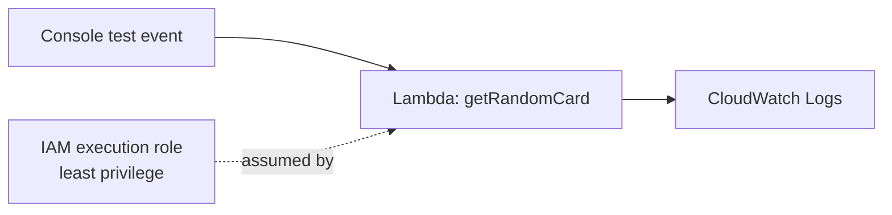
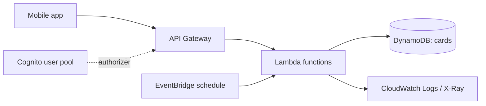

# AWS Flashcards

A small serverless flashcards app I'm building while preparing for the **AWS Certified Developer – Associate (DVA-C02)** exam.

Each step adds one AWS service I've just studied, so the project grows with the syllabus. The commit history and the notes in [`docs/`](docs) show the process step by step: what I built, why, and what I learned.

## Architecture

**Today**

**Where it's going**

## Build log

| Step | What I built | AWS services | Notes |
|---|---|---|---|
| 1 | First Lambda function that returns a random card, with its own least-privilege execution role | Lambda, IAM, CloudWatch Logs | [01-lambda-and-iam.md](docs/01-lambda-and-iam.md) |
| 2 | Versions, an alias and a canary release | Lambda | [02-versions-and-aliases.md](docs/02-versions-and-aliases.md) |
| 3 | HTTP endpoint with a Cognito authorizer | API Gateway, Cognito | _planned_ |
| 4 | Store cards and track the ones I get wrong | DynamoDB | _planned_ |
| 5 | Daily review reminder | EventBridge | _planned_ |
| 6 | Infrastructure as code, deployed with one command | AWS SAM, CloudFormation | _planned_ |
| 7 | Automatic deploys on every push | GitHub Actions / CodePipeline | _planned_ |

## Tech

- Node.js 24 (ES modules) on AWS Lambda
- Region: `eu-north-1` (Stockholm)
- Built in the AWS Console for now; moving to AWS SAM in step 6

## Security

No AWS credentials are stored in this repository. Each function gets only the permissions it needs through its IAM execution role.
