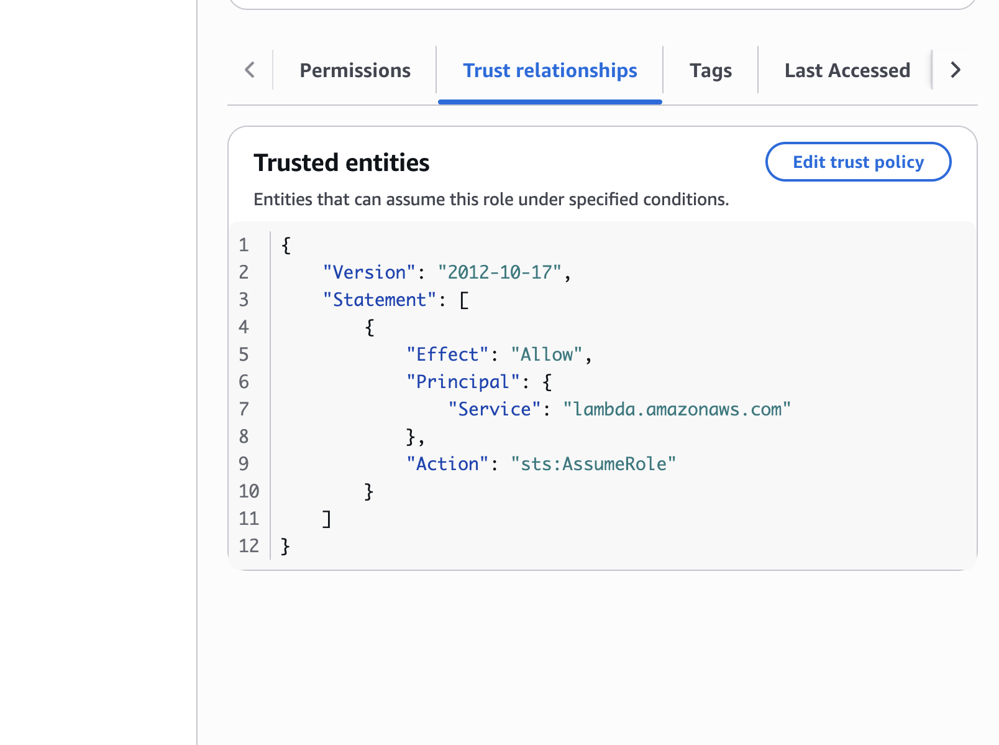

# Step 1: First Lambda function and its execution role

**Goal:** a Lambda function that returns a random flashcard, running with the smallest set of permissions it needs.

## What I built

1. **A billing alert first.** A zero-spend budget in AWS Budgets that emails me if the account spends anything at all.
2. **An IAM role for the function** (`flashcards-lambda-role`):
   - **Trust policy:** allows the Lambda service (`lambda.amazonaws.com`) to assume the role with `sts:AssumeRole`.
   - **Permissions:** only `AWSLambdaBasicExecutionRole`, so the function can write logs to CloudWatch and nothing else.
3. **The function** `getRandomCard` (Node.js 24) using that role. The console's default role was `PowerUserRole` with `PowerUserAccess`, far more than this function needs, so I replaced it with my own role.
4. **A test event** (`simple-test`, shareable) and a first successful run.




## What the test output told me

```
Duration: 39.40 ms   Billed Duration: 40 ms
Memory Size: 128 MB  Max Memory Used: 80 MB
Version: $LATEST
```

- The request ID in my log line comes from `context.awsRequestId`.
- `$LATEST` means I'm running unpublished code; no version has been published yet.
- Lambda gives CPU in proportion to memory, so a CPU-bound function is sped up by raising its memory.

## What I learned

- **Trust policy = who can use the role. Permissions = what the role can do.**
  If a service can't assume the role at all, the trust policy is wrong. If the function runs but gets `AccessDenied` on an action, the permissions are missing.
- **Least privilege matters even for a tiny function.** Defaults in the console can be much broader than needed.
- **Code outside the handler runs once per execution environment** and is reused by later invocations, so setup work belongs there.
- **Synchronous vs asynchronous invocation:** the console test waits for the response (synchronous). Services like S3, SNS and EventBridge invoke asynchronously, which is where retries, DLQs and destinations come in.
